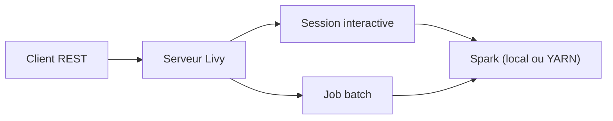

# apache/livy

> Serveur REST pour soumettre du code et des jobs Apache Spark depuis n'importe où.

## Le problème
Lancer du code sur un cluster Spark oblige à installer Spark et ses accès sur chaque poste client.

## Ce que ça fait vraiment
Livy expose une API REST vers Spark, en local ou sur YARN : shells interactifs Scala, Python et R, soumissions batch en Scala, Java, Python. Plusieurs utilisateurs partagent le serveur avec usurpation d'identité, sans modifier leurs programmes. Il faut une installation Spark à côté.

## Comment c'est branché
Schéma simplifié d'après la fiche, sans diagramme fourni.



## Essayer
```bash
git clone https://github.com/apache/livy.git
cd livy
mvn package
```

## Coût et pièges
Gratuit. Compilation Maven ; par défaut Spark 4.1.2, Scala 2.13 et JDK 17 ou 21, et profils `-Pspark3 -Pscala-2.12` pour Spark 3. Il faut un Spark à part.

## Ce que ce n'est pas
Pas un moteur de calcul : il relaie vers Spark. Le README ne décrit pas l'authentification ni l'exploitation, renvoyées au site.

## Alternatives
Aucune alternative citée dans le README.

## Pour toi
Surveiller : utile pour exposer Spark à des notebooks ou services, mais à comparer aux connexions directes. Même contenu que apache/incubator-livy.

