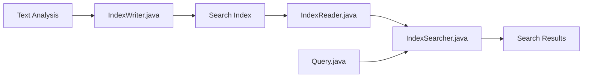

# apache/lucene

> Java full-text search library, the foundation of many search engines.

## The problem
Searching text efficiently requires an inverted index, linguistic analysis and relevance ranking.

## What it actually does
Analyses the text, writes an index (`IndexWriter`), opens it for reading (`IndexReader`), turns a query (`Query`) into something it replays through `IndexSearcher`. Extensions: facets, highlighting, grouping, suggestions, query monitoring, spatial search.

## How it is wired


## Trying it
```bash
# README : installer JDK 25, cloner le dépôt, lancer le script gradlew
./gradlew
```

## Cost and gotchas
JDK 25 required to build. A library to embed, not a server.

## What it is not
Not a ready-to-use search server. Thin README: the documentation is elsewhere.

## Alternatives
- None cited in the README.

## For you
Worth watching: it is the building block under a lot of search, useful to know before a lexical RAG, but you will rarely use it directly.
