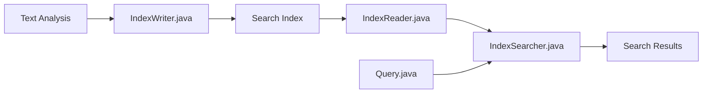

# apache/lucene

> Bibliothèque Java de recherche plein texte, base de nombreux moteurs de recherche.

## Le problème
Chercher efficacement dans du texte exige index inversé, analyse linguistique et classement de pertinence.

## Ce que ça fait vraiment
Analyse le texte, écrit un index (`IndexWriter`), l'ouvre en lecture (`IndexReader`), transforme une requête (`Query`) et la rejoue via `IndexSearcher`. Extensions : facettes, surlignage, regroupement, suggestions, monitoring de requêtes, recherche spatiale.

## Comment c'est branché


## Essayer
```bash
# README : installer JDK 25, cloner le dépôt, lancer le script gradlew
./gradlew
```

## Coût et pièges
JDK 25 requis pour compiler. Bibliothèque à intégrer, pas un serveur.

## Ce que ce n'est pas
Pas un serveur de recherche prêt à l'emploi. README mince : la documentation est ailleurs.

## Alternatives
- Aucune citée dans le README.

## Pour toi
À surveiller : c'est la brique sous beaucoup de recherche, utile à connaître avant un RAG lexical, mais tu l'utiliseras rarement en direct.

