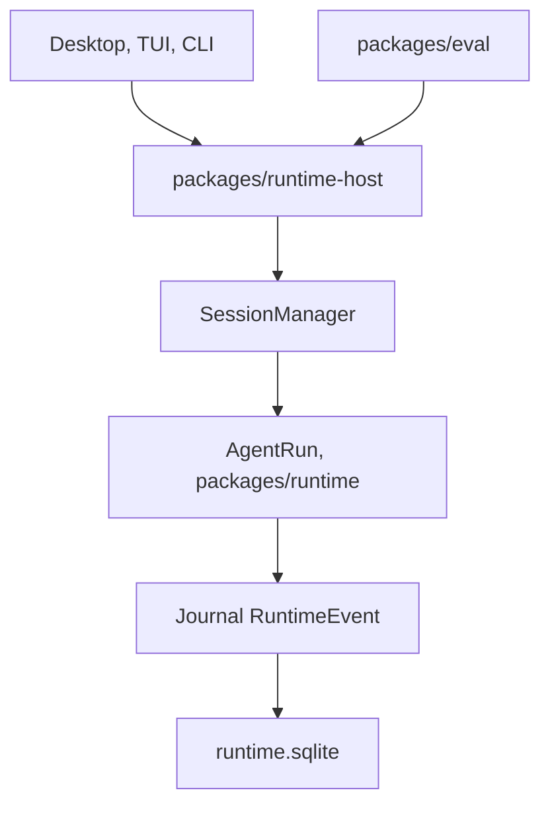

# apache/maka

> Local coding agent workspace that keeps a complete, replayable log of every action.

## The problem
Coding agents are hard to audit, to resume after a crash and to compare with each other.

## What it actually does
A single execution host drives Desktop (Electron), TUI and CLI. Every message, tool call and permission decision is an event appended to a log, of which the interface, the next prompt and crash recovery are projections. The model is your choice (API, local, gateway). An Eval module publishes benchmarks with an official verifier.

## How it is wired


## Trying it
```bash
git clone https://github.com/apache/maka.git
cd maka
npm ci
npm run dev
npm run cli:dev -- run "Summarize this repository and identify its most important risk"
```

## Cost and gotchas
You must supply an API key or a local model, Node 22.19 or 24, ripgrep. Keys are stored in plain text in credential-vault.json (readable by your account only). Resuming an interrupted turn: consumes tokens.

## What it is not
Not a stable release: Apache incubating project, created in May 2026, 423 open issues. Development versions are not Apache releases. Performance figures are published by the project.

## Alternatives
No alternative named in the README.

## For you
Worth watching: the idea of an event log and published benchmarks is relevant to agent evaluation, but the project is very young.
