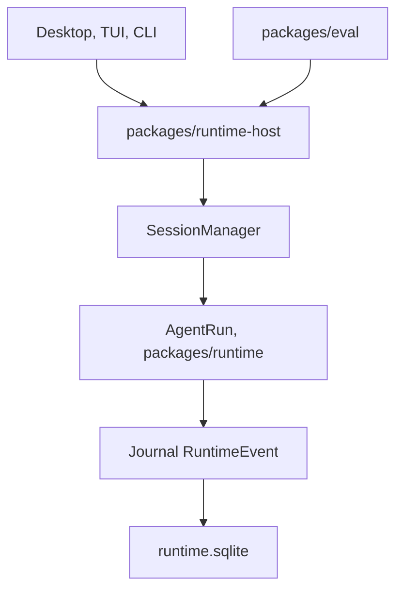

# apache/maka

> Espace de travail d'agent de code local, qui garde un journal complet et rejouable de chaque action.

## Le problème
Les agents de code sont difficiles à auditer, à reprendre après un plantage et à comparer entre eux.

## Ce que ça fait vraiment
Un hôte d'exécution unique pilote Desktop (Electron), TUI et CLI. Chaque message, appel d'outil et décision de permission est un événement ajouté à un journal, dont l'interface, le prompt suivant et la reprise sur incident sont des projections. Le modèle est au choix (API, local, passerelle). Un module Eval publie des benchmarks avec vérificateur officiel.

## Comment c'est branché


## Essayer
```bash
git clone https://github.com/apache/maka.git
cd maka
npm ci
npm run dev
npm run cli:dev -- run "Summarize this repository and identify its most important risk"
```

## Coût et pièges
Clé d'API ou modèle local à fournir, Node 22.19 ou 24, ripgrep. Les clés sont stockées en clair dans credential-vault.json (lisible par ton compte seulement). Reprise d'un tour interrompu : consomme des jetons.

## Ce que ce n'est pas
Pas une version stable : projet en incubation Apache, créé en mai 2026, 423 issues ouvertes. Les versions de développement ne sont pas des releases Apache. Les chiffres de performance sont publiés par le projet.

## Alternatives
Aucune alternative nommée dans le README.

## Pour toi
À surveiller : l'idée d'un journal d'événements et de benchmarks publiés intéresse l'évaluation d'agents, mais le projet est très jeune.

