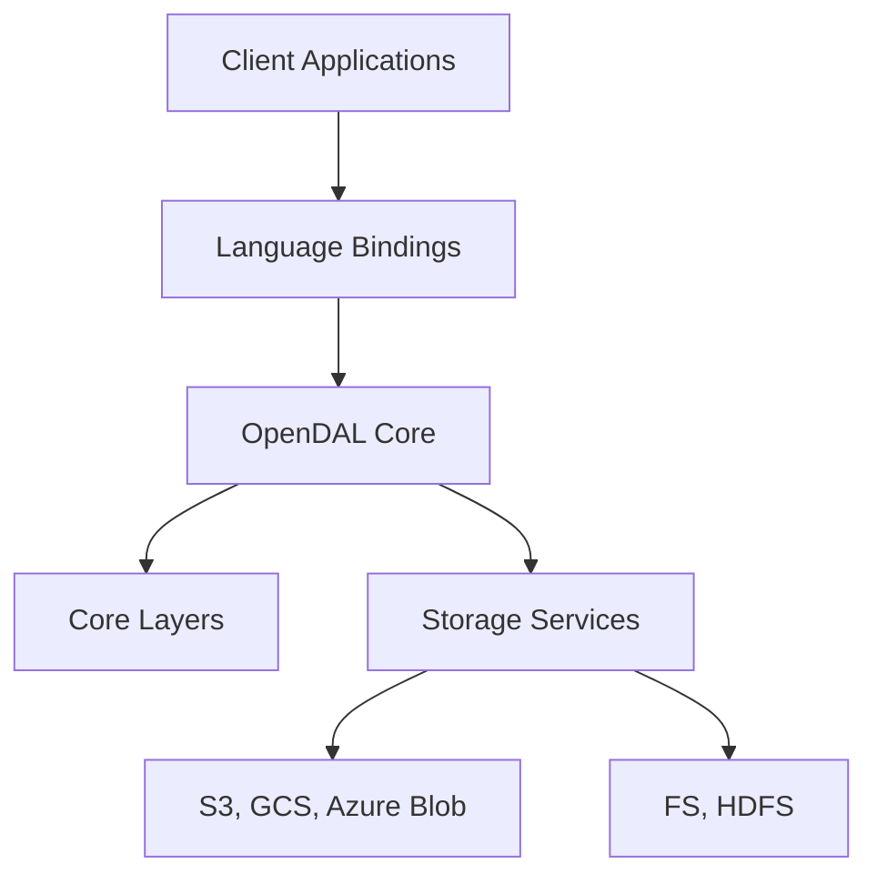

# apache/opendal

> Unified storage access layer, in Rust with multi-language bindings, for applications and data systems.

## The problem
Each storage backend (S3, GCS, HDFS, databases, SaaS) has its own client, which multiplies code and error behaviors.

## What it actually does
The `Operator` abstraction gives a common API to dozens of services: object stores, files, SaaS, databases, protocols, key-value stores. Pluggable layers provide retry, timeout, logging, tracing, Prometheus and OpenTelemetry metrics, rate limiting and caching. Bindings exist for Python, Java, Node.js, Go, C, C++, Ruby, Swift and others. Each binding has its own version.

## How it is wired

## Trying it
The README gives no install command: it points to each binding's packages and the examples folder. Not documented here.

## Cost and gotchas
Free. Enable only the services you need. Check the version of the binding you choose, which is distinct from the Rust core's. Access to cloud services remains at your expense.

## What it is not
Not a storage system: it stores nothing itself, it accesses existing services. It is not a query engine.

## Alternatives
No alternative named in the README.

## For you
Worth adopting to read and write pipeline data across several storage backends with a single API, under Apache governance.
