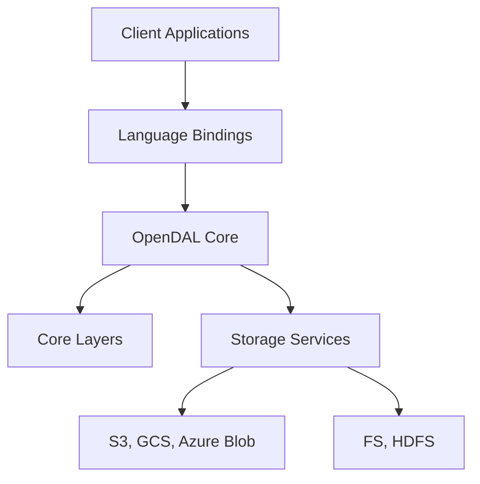

# apache/opendal

> Couche d'accès unifiée au stockage, en Rust avec liaisons multi-langages, pour applications et systèmes de données.

## Le problème
Chaque stockage (S3, GCS, HDFS, bases, SaaS) a son propre client, ce qui multiplie le code et les comportements d'erreur.

## Ce que ça fait vraiment
L'abstraction `Operator` donne une API commune à des dizaines de services : objet, fichiers, SaaS, bases, protocoles, clés-valeurs. Des couches ajoutables apportent retry, timeout, journalisation, traçage, métriques Prometheus et OpenTelemetry, limitation de débit et cache. Des liaisons existent pour Python, Java, Node.js, Go, C, C++, Ruby, Swift et d'autres. Chaque liaison a sa propre version.

## Comment c'est branché

## Essayer
Le README ne donne pas de commande d'installation : il renvoie vers les paquets de chaque liaison et le dossier d'exemples. Non documenté ici.

## Coût et pièges
Gratuit. Activer uniquement les services nécessaires. Vérifier la version de la liaison choisie, distincte de celle du cœur Rust. Les accès aux services cloud restent à ta charge.

## Ce que ce n'est pas
Pas un système de stockage : il ne stocke rien lui-même, il accède à des services existants. Ce n'est pas un moteur de requêtes.

## Alternatives
Aucune alternative nommée dans le README.

## Pour toi
À adopter pour lire et écrire des données de pipelines sur plusieurs stockages avec une seule API, sous gouvernance Apache.

