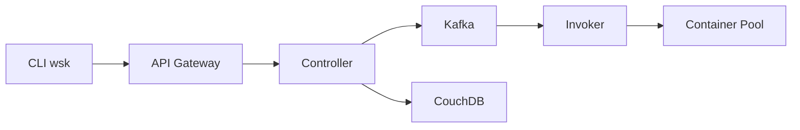

# apache/openwhisk

> Serverless platform for functions, triggers and rules, for private cloud operators.

## The problem
Running functions on demand without managing servers, on your own infrastructure.

## What it actually does
Actions run in Docker containers, triggers and rules link events to functions, and functions can be composed into workflows. Based on the structure: controller, load balancer, scheduler, invoker, Kafka, CouchDB, Zookeeper (written design diagram, not verified). Move to Apache Pekko: a breaking change, you must redeploy a new cluster.

## How it is wired


## Trying it
```bash
git clone https://github.com/apache/openwhisk.git
cd openwhisk
./gradlew core:standalone:bootRun
wsk property set --apihost 'http://localhost:3233' --auth '23bc46b1-71f6-4ed5-8c54-816aa4f8c502:123zO3xZCLrMN6v2BKK1dXYFpXlPkccOFqm12CdAsMgRU4VrNZ9lyGVCGuMDGIwP'
```

## Cost and gotchas
Docker, Java and Node required; heavy Kubernetes deployment. Compatibility break (Akka → Pekko) dated 17/10/2025; 3.x branch upcoming. Last push 2026-09-08.

## What it is not
Not a managed service: you operate everything. Not designed for GPU inference.

## Alternatives
No alternative named in the README.

## For you
Watch: self-hosted event-driven functions; out of scope if you target native Kubernetes or the managed cloud.
