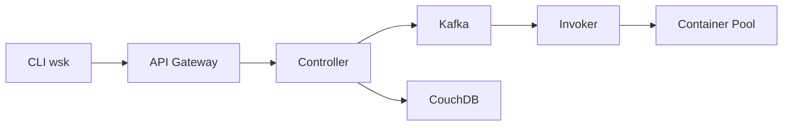

# apache/openwhisk

> Plateforme serverless de fonctions, déclencheurs et règles, pour opérateurs de cloud privé.

## Le problème
Exécuter des fonctions à la demande sans gérer de serveurs, sur sa propre infrastructure.

## Ce que ça fait vraiment
Actions exécutées dans des conteneurs Docker, déclencheurs et règles pour relier événements et fonctions, composition en workflows. D'après la structure : contrôleur, répartiteur, ordonnanceur, invoker, Kafka, CouchDB, Zookeeper (schéma de conception rédigé, non vérifié). Passage à Apache Pekko : changement incompatible, il faut redéployer un nouveau cluster.

## Comment c'est branché


## Essayer
```bash
git clone https://github.com/apache/openwhisk.git
cd openwhisk
./gradlew core:standalone:bootRun
wsk property set --apihost 'http://localhost:3233' --auth '23bc46b1-71f6-4ed5-8c54-816aa4f8c502:123zO3xZCLrMN6v2BKK1dXYFpXlPkccOFqm12CdAsMgRU4VrNZ9lyGVCGuMDGIwP'
```

## Coût et pièges
Docker, Java, Node requis ; déploiement Kubernetes lourd. Rupture de compatibilité (Akka → Pekko) à la date du 17/10/2025 ; branche 3.x à venir. Dernier push 2026-09-08.

## Ce que ce n'est pas
Pas un service géré : tu opères tout. Pas conçu pour de l'inférence GPU.

## Alternatives
Aucune alternative nommée dans le README.

## Pour toi
À surveiller : fonctions événementielles auto-hébergées ; hors périmètre si tu vises Kubernetes natif ou le cloud géré.

