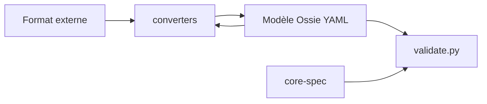

# apache/ossie

> Open semantic model specification for exchanging business definitions between BI tools and AI agents.

## The problem
The same KPI is defined differently in each tool, and AI agents produce unreliable results on inconsistent business logic.

## What it actually does
Provides a JSON/YAML specification (`core-spec/spec.md`, `spec.yaml`, JSON schema), a validator (`validation/validate.py`), examples (TPC-DS) and reference converters: dbt, Omni, Orionbelt, GoodData, Honeydew in Python; Polaris and Salesforce in Java. Former name: Open Semantic Interchange (OSI). Apache incubating project.

## How it is wired

## Trying it
No command documented in the README.

## Cost and gotchas
Free. Young specification (repository created in November 2025): converters may report lossy mappings. The README does not detail installation.

## What it is not
Not an executable semantic layer nor a service: it is a specification with adapters. No unified runtime.

## Alternatives
The README cites dbt, GoodData, Polaris and Salesforce as formats to convert, not as competitors.

## For you
Keep an eye on it: a business-semantics exchange standard may matter for agents working on data, but it is still incubating.
