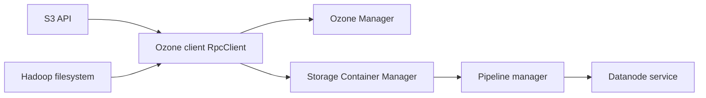

# apache/ozone

> Distributed, redundant object storage for Hadoop and cloud-native, with an S3 API and Hadoop filesystem.

## The problem
Storing billions of files and blocks consistently, beyond the limits of classic distributed filesystems.

## What it actually does
Exposes S3 and the Hadoop filesystem. Ozone Manager handles metadata, the Storage Container Manager handles containers and pipelines, datanodes store blocks with replication or erasure coding. Consistency via Raft, Kerberos security, ACLs, Ranger, TDE and in-transit encryption. Runs on Kubernetes and YARN.

## How it is wired


## Trying it
```bash
curl -O https://raw.githubusercontent.com/apache/ozone-docker/refs/heads/latest/docker-compose.yaml
docker compose up -d --scale datanode=3
mvn clean install -DskipTests
```

## Cost and gotchas
Free; a realistic cluster requires several datanodes and resources. Replication factor set to 1 by default in the example.

## What it is not
Not a simple local MinIO: the README targets large installations. The announced performance ("tens of billions") is not quantified.

## Alternatives
No alternative named in the README.

## For you
Worth watching: S3-compatible object storage relevant for an on-premise data lake, heavy to operate for a small need.
