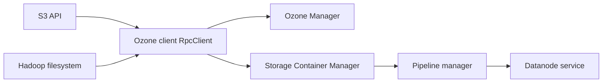

# apache/ozone

> Stockage objet distribué et redondant pour Hadoop et le cloud natif, avec API S3 et système de fichiers Hadoop.

## Le problème
Stocker des milliards de fichiers et de blocs de façon cohérente, au-delà des limites des systèmes de fichiers distribués classiques.

## Ce que ce n'est pas
Voir plus bas.

## Ce que ça fait vraiment
Expose S3 et le système de fichiers Hadoop. Ozone Manager gère les métadonnées, le Storage Container Manager gère conteneurs et pipelines, les datanodes stockent les blocs avec réplication ou erasure coding. Cohérence par Raft, sécurité Kerberos, ACL, Ranger, chiffrement TDE et sur le réseau. Fonctionne sur Kubernetes et YARN.

## Comment c'est branché


## Essayer
```bash
curl -O https://raw.githubusercontent.com/apache/ozone-docker/refs/heads/latest/docker-compose.yaml
docker compose up -d --scale datanode=3
mvn clean install -DskipTests
```

## Coût et pièges
Gratuit ; un cluster réaliste demande plusieurs datanodes et des ressources. Facteur de réplication à 1 par défaut dans l'exemple.

## Ce que ce n'est pas
Pas un simple MinIO local : le README vise de grandes installations. Les performances annoncées (« dizaines de milliards ») ne sont pas chiffrées.

## Alternatives
Aucune alternative nommée dans le README.

## Pour toi
À surveiller : stockage objet compatible S3 pertinent pour un data lake on-premise, lourd à opérer pour un petit besoin.

