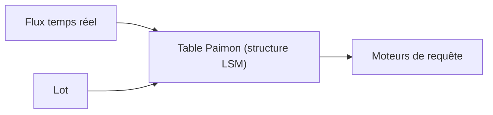

# apache/paimon

> Data lake format combining LSM and real-time updates, for Flink and Spark.

## The problem
Classic lake formats handle continuous updates coming from streaming poorly.

## What it actually does
Table format for a real-time "lakehouse" architecture, unifying streaming and batch, applying an LSM structure. Formerly Flink Table Store; its architecture is inspired by Iceberg. The README says no more than that: all the detail is on the project website.

## How it is wired
Simplified diagram based on the README, no diagram provided.



## Trying it
```bash
mvn clean install -DskipTests
mvn spotless:apply
```

## Cost and gotchas
Build with JDK 8/11 and Maven ≥ 3.6.3. Flink or Spark is required to use it.

## What it is not
Not a compute engine: a storage format. The README is mostly mailing lists.

## Alternatives
- Apache Iceberg: cited as the source of inspiration for the architecture.

## For you
Worth watching: interesting for streaming into a lake, but the README does not allow a judgment; check the official documentation.
