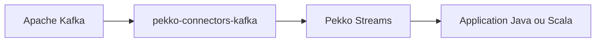

# apache/pekko-connectors-kafka

> Kafka connector for Pekko Streams, in Java and Scala, a fork of Alpakka Kafka 3.0.1.

## The problem
Connecting Kafka to reactive streams with backpressure takes a lot of integration code.

## What it actually does
Links Apache Kafka to Pekko Streams, an implementation of Reactive Streams, with a stream DSL and backpressure. Fork of Alpakka Kafka 3.0.1, from before Akka moved to the Business Source License. Documentation is at pekko.apache.org.

## How it is wired
Simplified diagram based on the sheet, no diagram provided.



## Trying it
```bash
sbt compile
sbt test      # Docker requis
sbt docs/paradox
```

## Cost and gotchas
Free. JDK 8+, sbt, Docker for tests, Graphviz for the docs.

## What it is not
Not a standalone Kafka client: it assumes Pekko Streams.

## Alternatives
Alpakka Kafka, which it forks (the Akka license changed).

## For you
Worth watching: useful if your streaming stack is Scala or Java with Pekko, otherwise outside the Python scope.
