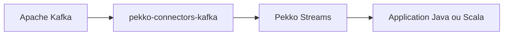

# apache/pekko-connectors-kafka

> Connecteur Kafka pour Pekko Streams, en Java et Scala, fork d'Alpakka Kafka 3.0.1.

## Le problème
Brancher Kafka à des flux réactifs avec contre-pression demande beaucoup de code d'intégration.

## Ce que ça fait vraiment
Relie Apache Kafka à Pekko Streams, implémentation de Reactive Streams, avec DSL de flux et contre-pression. Fork d'Alpakka Kafka 3.0.1, avant le passage d'Akka à la Business Source License. La documentation est sur pekko.apache.org.

## Comment c'est branché
Schéma simplifié d'après la fiche, sans diagramme fourni.



## Essayer
```bash
sbt compile
sbt test      # Docker requis
sbt docs/paradox
```

## Coût et pièges
Gratuit. JDK 8+, sbt, Docker pour les tests, Graphviz pour la doc.

## Ce que ce n'est pas
Pas un client Kafka autonome : il suppose Pekko Streams.

## Alternatives
Alpakka Kafka, dont il est le fork (la licence Akka a changé).

## Pour toi
À surveiller : sert si ta pile de streaming est en Scala ou Java avec Pekko, sinon hors périmètre Python.

