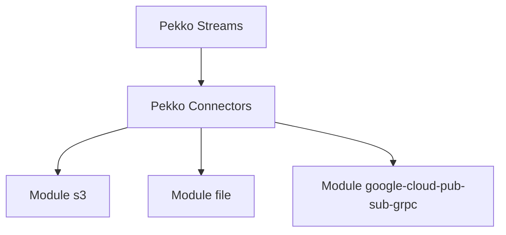

# apache/pekko-connectors

> Reactive integration connectors for Java and Scala, built on Pekko Streams, a fork of Alpakka 4.0.0.

## The problem
Linking heterogeneous systems without one overwhelming the other requires backpressure handling.

## What it actually does
A collection of modules, for example s3, file and google-cloud-pub-sub-grpc, for integration pipelines on Pekko Streams. Fork of Alpakka before its switch to the Business Source License. Modules may lose binary compatibility or disappear without notice.

## How it is wired
Simplified diagram based on the sheet, no diagram provided.



## Trying it
```bash
# Aucune commande documentée : voir la page de contribution pour les tests
```

## Cost and gotchas
Java 17 to build the main branch; Pekko 1.x builds better with Java 8. Java is not in the list of prerequisites. Compatibility between versions is not guaranteed.

## What it is not
Not a Kafka library on its own: Kafka has its own connectors repository.

## Alternatives
- Alpakka: the original version, moved to the Business Source License.

## For you
Ignore: JVM integration, outside your scope unless you do streaming on Scala.
