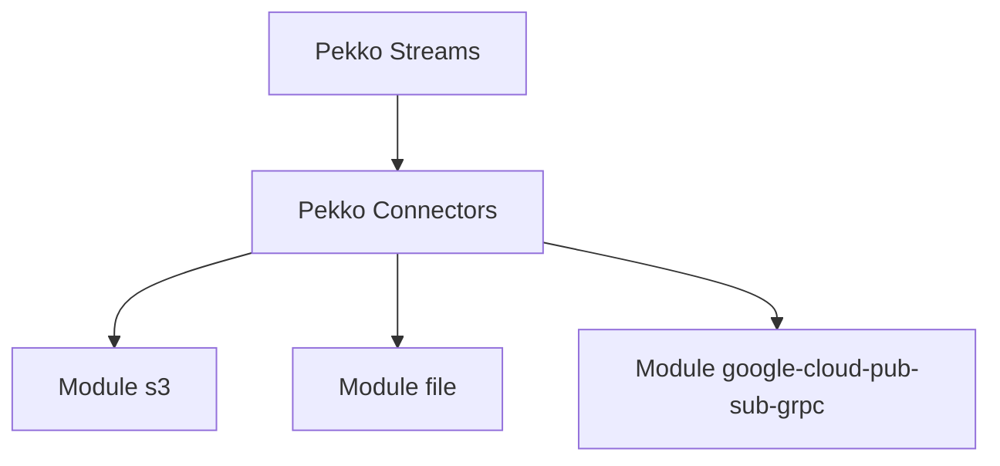

# apache/pekko-connectors

> Connecteurs d'intégration réactifs pour Java et Scala, bâtis sur Pekko Streams, fork d'Alpakka 4.0.0.

## Le problème
Relier des systèmes hétérogènes sans que l'un submerge l'autre demande une gestion de la contre-pression.

## Ce que ça fait vraiment
Collection de modules, avec par exemple s3, file et google-cloud-pub-sub-grpc, pour des pipelines d'intégration sur Pekko Streams. Fork d'Alpakka avant son passage à la Business Source License. Les modules peuvent perdre la compatibilité binaire ou disparaître sans préavis.

## Comment c'est branché
Schéma simplifié d'après la fiche, sans diagramme fourni.



## Essayer
```bash
# Aucune commande documentée : voir la page de contribution pour les tests
```

## Coût et pièges
Java 17 pour compiler la branche principale ; Pekko 1.x se compile mieux avec Java 8. Java n'est pas dans la liste des prérequis. Compatibilité entre versions non garantie.

## Ce que ce n'est pas
Pas une bibliothèque Kafka à elle seule : Kafka a son propre dépôt de connecteurs.

## Alternatives
- Alpakka : version d'origine, passée sous Business Source License.

## Pour toi
Ignorer : de l'intégration JVM, hors de ton périmètre sauf si tu fais du streaming sur Scala.

