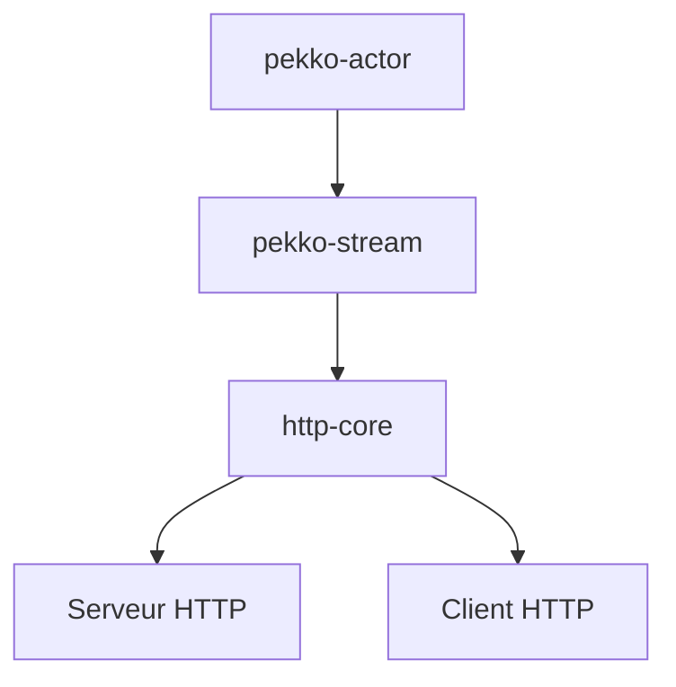

# apache/pekko-http

> HTTP client and server stack for Scala and Java built on pekko-actor and pekko-stream.

## The problem
Provide or consume HTTP services with a reactive stream, without an imposed web framework.

## What it actually does
HTTP server and client modules built on pekko-actor and pekko-stream, with several API levels. Fork of Akka HTTP 10.2.x from before Akka moved to the Business Source License.

## How it is wired
Simplified diagram based on the sheet, no diagram provided.


## Trying it
```bash
sbt compile
sbt test
sbt publishLocal
```

## Cost and gotchas
Free. JDK 17 minimum and sbt required; Graphviz for the docs.

## What it is not
Not a full web framework: an HTTP toolbox.

## Alternatives
Akka HTTP: the project it is forked from, but under the Business Source License.

## For you
Ignore: generic Scala/JVM stack, unrelated to your data/AI/MLOps work.
