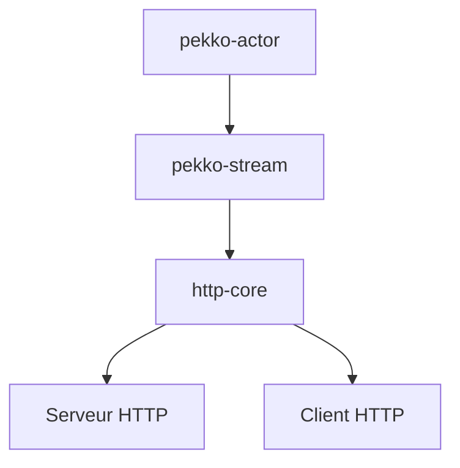

# apache/pekko-http

> Pile HTTP client et serveur pour Scala et Java sur pekko-actor et pekko-stream.

## Le problème
Fournir ou consommer des services HTTP avec un flux réactif, sans framework web imposé.

## Ce que ça fait vraiment
Modules serveur et client HTTP bâtis sur pekko-actor et pekko-stream, avec plusieurs niveaux d'API. Fork d'Akka HTTP 10.2.x avant le passage d'Akka à la Business Source License.

## Comment c'est branché
Schéma simplifié d'après la fiche, sans diagramme fourni.


## Essayer
```bash
sbt compile
sbt test
sbt publishLocal
```

## Coût et pièges
Gratuit. JDK 17 minimum et sbt requis ; Graphviz pour la doc.

## Ce que ce n'est pas
Pas un framework web complet : une boîte à outils HTTP.

## Alternatives
Akka HTTP : dont il est le fork, mais sous Business Source License.

## Pour toi
À ignorer : pile Scala/JVM générique, sans lien avec ton travail data/IA/MLOps.

