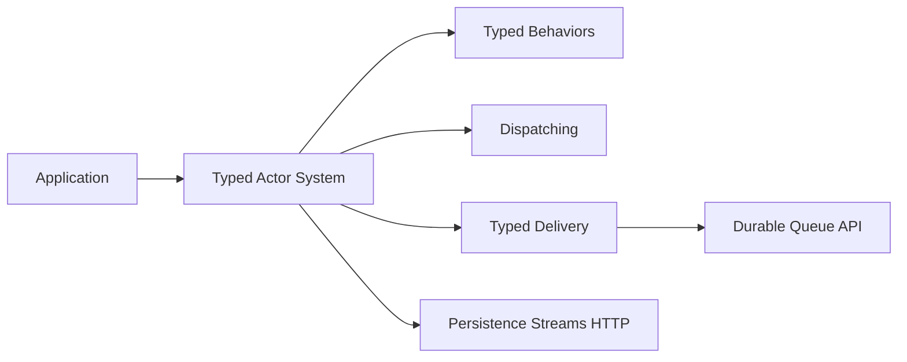

# apache/pekko

> JVM actor framework for concurrent and distributed applications, a fork of Akka 2.6 under the Apache license.

## The problem
Writing concurrent, distributed and resilient systems without managing threads by hand, and without Akka's BSL license.

## What it actually does
Provides an actor model (classic and typed), supervision, a dispatcher, typed reliable delivery, cluster singleton, and persistence, streams and HTTP libraries. It is a fork of Akka 2.6.x predating its BSL license, with a few features from Akka 2.7.0. Built with sbt and JDK 17.

## How it is wired


## Trying it
```bash
sbt compile
sbt test
sbt package
sbt publishLocal
```

## Cost and gotchas
Free. The README flags build problems on Windows. Graphviz is required for the docs.

## What it is not
Not a data tool: the README mentions neither Spark nor ML. No compatibility guarantee with recent Akka versions.

## Alternatives
Akka, of which Pekko is the fork, cited in the README (BSL license).

## For you
Ignore unless you write concurrent Scala/Java: useful for JVM pipelines, but far from a day-to-day Python workflow.
