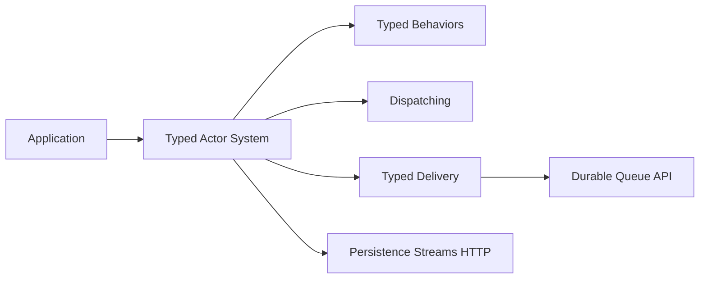

# apache/pekko

> Framework JVM à acteurs pour applications concurrentes et distribuées, fork d'Akka 2.6 sous licence Apache.

## Le problème
Écrire des systèmes concurrents, distribués et résilients sans gérer les threads à la main, sans la licence BSL d'Akka.

## Ce que ça fait vraiment
Fournit un modèle d'acteurs (classique et typé), la supervision, un dispatcher, de la livraison fiable typée, du cluster singleton, et des bibliothèques de persistance, streams et HTTP. C'est un fork d'Akka 2.6.x antérieur à sa licence BSL, avec quelques fonctions d'Akka 2.7.0. Build avec sbt et JDK 17.

## Comment c'est branché


## Essayer
```bash
sbt compile
sbt test
sbt package
sbt publishLocal
```

## Coût et pièges
Gratuit. Le README signale des problèmes de build sous Windows. Graphviz requis pour la doc.

## Ce que ce n'est pas
Pas un outil data : le README ne parle ni de Spark ni de ML. Pas de garantie de compatibilité avec les versions récentes d'Akka.

## Alternatives
Akka, dont Pekko est le fork, cité dans le README (licence BSL).

## Pour toi
À ignorer sauf si tu écris du Scala/Java concurrent : utile pour des pipelines JVM, mais éloigné d'un quotidien Python.

