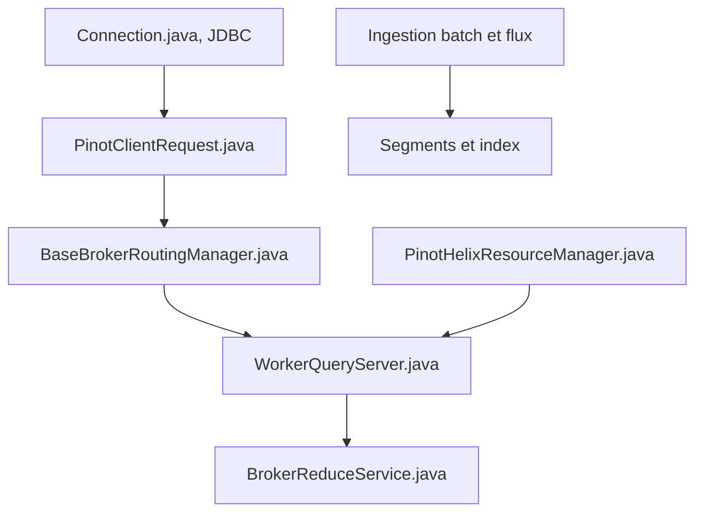

# apache/pinot

> Distributed real-time OLAP database for low-latency SQL queries, for analytics and data teams.

## The problem
Serving aggregations on fresh data to thousands of concurrent users goes beyond what classic warehouses do.

## What it actually does
Ingests streams (Kafka, Pulsar, Kinesis) and batches (HDFS, S3...), stores them as columnar segments with pluggable indexes and real-time upsert. A broker routes SQL queries to servers, then reduces the results. The README adds vector search (RAG, recommendation).

## How it is wired


## Trying it
```bash
docker run --rm --name pinot-quickstart \
  -p 127.0.0.1:9000:9000 \
  apachepinot/pinot:1.6.0 QuickStart -type batch
```

## Cost and gotchas
Docker with at least 6 GB of memory for the demo. Build: JDK 25 minimum. Operating a full cluster (broker, servers, controller) is non-trivial. 1,279 open issues.

## What it is not
Not a transactional database nor a general-purpose warehouse: designed for analytics on nearly immutable data. The diagram flags links between services that are not verified in the code.

## Alternatives
No alternative named in the README (Trino and Superset are cited as integrations).

## For you
Keep an eye on it: relevant if you serve real-time analytics or RAG at large scale, too heavy for occasional use.
