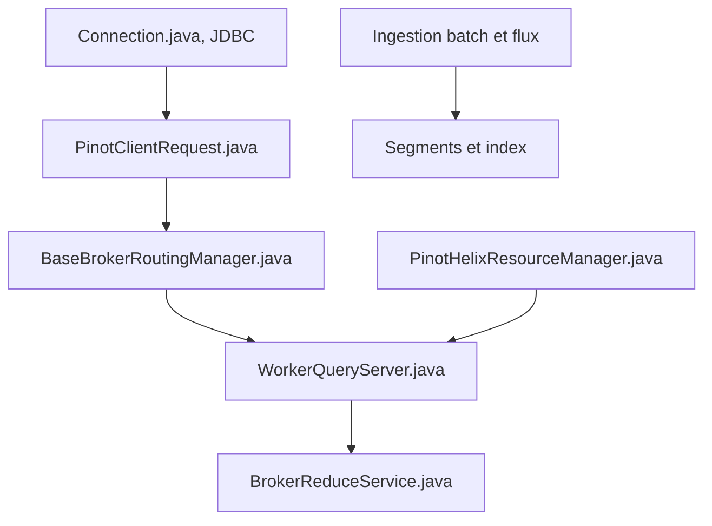

# apache/pinot

> Base OLAP distribuée temps réel pour requêtes SQL à faible latence, pour équipes d'analytique et de données.

## Le problème
Servir des agrégations sur des données fraîches à des milliers d'utilisateurs en parallèle dépasse ce que font les entrepôts classiques.

## Ce que ça fait vraiment
Ingère des flux (Kafka, Pulsar, Kinesis) et des lots (HDFS, S3...), les stocke en segments en colonnes avec index enfichables et upsert temps réel. Un broker route les requêtes SQL vers des serveurs, puis réduit les résultats. Le README ajoute la recherche vectorielle (RAG, recommandation).

## Comment c'est branché


## Essayer
```bash
docker run --rm --name pinot-quickstart \
  -p 127.0.0.1:9000:9000 \
  apachepinot/pinot:1.6.0 QuickStart -type batch
```

## Coût et pièges
Docker avec au moins 6 Go de mémoire pour la démo. Compilation : JDK 25 minimum. Exploitation d'un cluster complet (broker, serveurs, contrôleur) non triviale. 1 279 issues ouvertes.

## Ce que ce n'est pas
Pas une base transactionnelle ni un entrepôt généraliste : conçu pour de l'analytique sur données quasi immuables. Le diagramme signale des liens entre services non vérifiés dans le code.

## Alternatives
Aucune alternative nommée dans le README (Trino et Superset sont cités comme intégrations).

## Pour toi
À surveiller : pertinent si tu sers de l'analytique temps réel ou du RAG à grande échelle, trop lourd pour un usage ponctuel.

