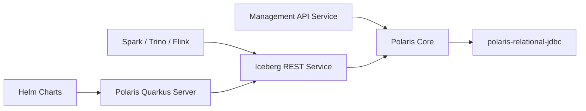

# apache/polaris

> Open source catalog for Apache Iceberg, implementing the Iceberg REST API for several engines.

## The problem
Several engines (Spark, Trino, Flink) must share Iceberg tables through a single catalog, without depending on a vendor.

## What it actually does
Quarkus server that exposes the Iceberg REST API and a management API. The core (`polaris-core`) handles entities and logic, persistence goes through relational JDBC; extensions cover catalog federation (Hive, Hadoop, BigQuery) and external authorization (OPA, Ranger). A Python client, a Spark plugin, Helm charts and an administration tool are provided.

## How it is wired


## Trying it
```bash
docker run -p 8181:8181 -p 8182:8182 apache/polaris:latest
./gradlew run
./regtests/run_spark_sql.sh
```

## Cost and gotchas
Building requires Java 21+ and Docker 27+. Default credentials `POLARIS,root,s3cr3t` must be replaced. 388 open issues. The README does not quantify the resources needed.

## What it is not
Not a query engine nor storage: it holds the Iceberg metadata catalog.

## Alternatives
- No alternative named in the README.

## For you
Keep an eye on it: useful if your data platform relies on multi-engine Iceberg, off-topic otherwise.
