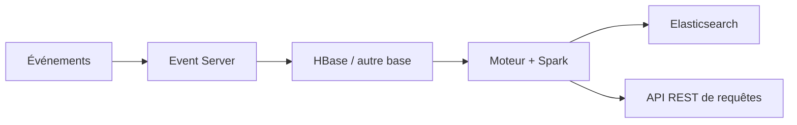

# apache/predictionio

> Open source machine learning framework for collecting events, deploying algorithms and querying predictions over REST.

## The problem
Putting a recommendation or classification engine into production requires connecting event collection, training, evaluation and query serving.

## What it actually does
Offers event collection, algorithm deployment, evaluation and querying of predictive results through a REST API. It relies on Hadoop, HBase (or other databases), Elasticsearch and Spark, and implements a Lambda architecture. The README offers three engine templates: recommendation, similar products, classification.

## How it is wired

## Trying it
No command documented: the README points to predictionio.apache.org (installation from source or Docker, getting-started guides for the three templates).

## Cost and gotchas
Free, Apache-2.0. The repository is archived (last push on 2021-01-09) and the continuous integration badge in the README points to Travis CI. Hadoop, HBase, Elasticsearch and Spark must be installed and operated yourself, hence a heavy stack.

## What it is not
Not a maintained project: no more security fixes expected. Not a lightweight tool: it imposes a whole Big Data stack.

## Alternatives
None named in the README.

## For you
Ignore: archived since 2021 and built on a Hadoop/HBase/Spark stack from another era; read it only for the history of the Lambda architecture.
