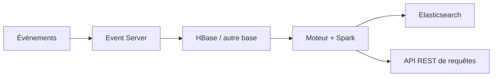

# apache/predictionio

> Framework d'apprentissage automatique open source pour collecter des événements, déployer des algorithmes et interroger des prédictions par REST.

## Le problème
Mettre un moteur de recommandation ou de classification en production demande de relier collecte d'événements, entraînement, évaluation et service de requêtes.

## Ce que ça fait vraiment
Propose la collecte d'événements, le déploiement d'algorithmes, l'évaluation et l'interrogation de résultats prédictifs par API REST. Il s'appuie sur Hadoop, HBase (ou d'autres bases), Elasticsearch et Spark, et implémente une architecture Lambda. Le README propose trois modèles de moteur : recommandation, produits similaires, classification.

## Comment c'est branché

## Essayer
Aucune commande documentée : le README renvoie vers predictionio.apache.org (installation depuis les sources ou Docker, guides de démarrage des trois modèles).

## Coût et pièges
Gratuit, Apache-2.0. Le dépôt est archivé (dernier push le 2021-01-09) et le badge d'intégration continue du README pointe vers Travis CI. Hadoop, HBase, Elasticsearch et Spark à installer et exploiter soi-même, d'où une pile lourde.

## Ce que ce n'est pas
Pas un projet maintenu : plus de correctifs de sécurité attendus. Pas un outil léger : il impose toute une pile Big Data.

## Alternatives
Aucune nommée dans le README.

## Pour toi
Ignorer : archivé depuis 2021 et fondé sur une pile Hadoop/HBase/Spark d'une autre époque ; à ne lire que pour l'historique de l'architecture Lambda.

