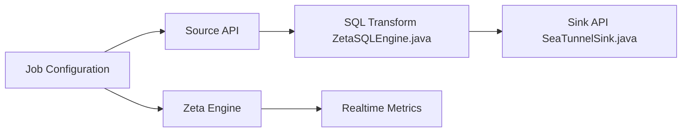

# apache/seatunnel

> Distributed data integration tool with more than 160 connectors, for batch, streaming and CDC.

## The problem
Synchronizing heterogeneous sources (databases, files, images) to targets requires connectors and consistency.

## What it actually does
You describe a configuration job and choose an engine (Zeta, Flink or Spark); source connectors read, transformations (SQL) process, sink connectors write. Handles real time, CDC, multi-table, distributed snapshots, metrics and job history, REST services.

## How it is wired


## Trying it
```bash
# Le README renvoie vers le site pour le téléchargement et le déploiement ; aucune commande n'y figure.
```

## Cost and gotchas
Free. An execution engine (Zeta, Spark or Flink) and a Java machine are needed; cluster deployment is not detailed in the README. 889 open issues.

## What it is not
Not a workflow orchestrator nor a warehouse. The "multimodal" support is claimed by the README, not verified here.

## Alternatives
No alternative named in the README; the Flink and Spark engines are execution options.

## For you
Worth watching: relevant for enterprise data pipelines (CDC, multi-source), but heavier than a Python script for small volumes.
