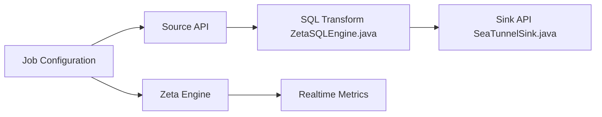

# apache/seatunnel

> Outil distribué d'intégration de données avec plus de 160 connecteurs, en batch, streaming et CDC.

## Le problème
Synchroniser des sources hétérogènes (bases, fichiers, images) vers des cibles demande des connecteurs et de la cohérence.

## Ce que ça fait vraiment
Tu décris un job de configuration, choisis un moteur (Zeta, Flink ou Spark) ; des connecteurs sources lisent, des transformations (SQL) traitent, des connecteurs de sortie écrivent. Gère temps réel, CDC, multi-tables, instantanés distribués, métriques et historique des jobs, services REST.

## Comment c'est branché


## Essayer
```bash
# Le README renvoie vers le site pour le téléchargement et le déploiement ; aucune commande n'y figure.
```

## Coût et pièges
Gratuit. Il faut un moteur d'exécution (Zeta, Spark ou Flink) et une machine Java ; déploiement en cluster non détaillé dans le README. 889 issues ouvertes.

## Ce que ce n'est pas
Pas un orchestrateur de workflows ni un entrepôt. La prise en charge « multimodale » est affirmée par le README, non vérifiée ici.

## Alternatives
Aucune alternative nommée dans le README ; les moteurs Flink et Spark sont des options d'exécution.

## Pour toi
À surveiller : pertinent pour des pipelines de données en entreprise (CDC, multi-sources), mais plus lourd qu'un script Python pour de petits volumes.

