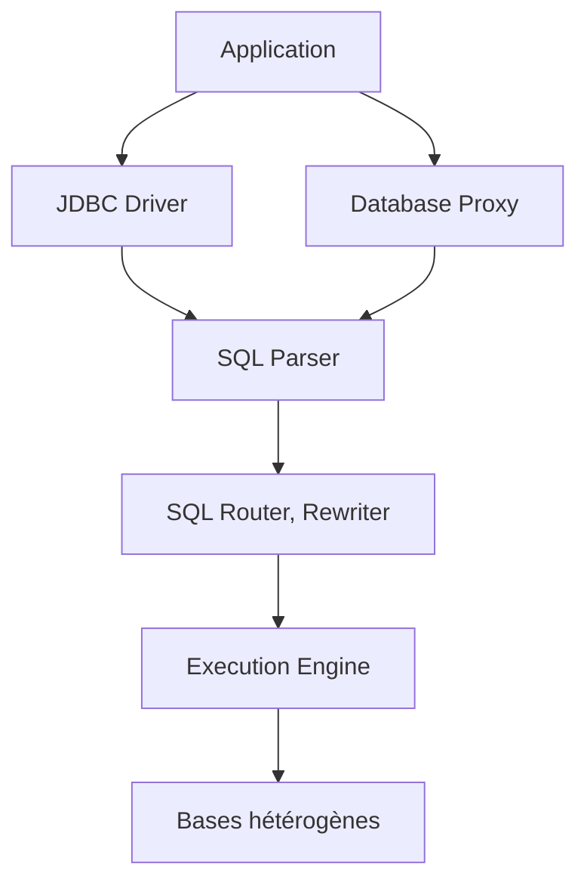

# apache/shardingsphere

> Enhancement layer on top of heterogeneous databases: sharding, encryption and SQL federation, via JDBC or proxy.

## The problem
Turning a set of heterogeneous or sharded databases into unified access, without migrating to a distributed database.

## What it actually does
Two entry points: ShardingSphere-JDBC (Java driver) and ShardingSphere-Proxy (MySQL/PostgreSQL protocol). SQL is parsed, routed, rewritten, executed then merged. Features: sharding, read/write splitting, distributed transactions, encryption, masking, shadow database, observability, DistSQL, data migration, MCP workflows.

## How it is wired

## Trying it
No command in the README (it points to the wiki and the official documentation).

## Cost and gotchas
The JDBC ANTLR cache can bloat the Java heap: set `-Xmx`. A registry (ZooKeeper, etcd) must be operated for governance.

## What it is not
Not a database: it relies on your existing databases. Java-oriented repo.

## Alternatives
No alternative named in the README (it only compares to distributed databases, middleware and cloud offerings).

## For you
Ignore: designed for OLTP sharding in Java, outside the usual needs of a data/AI profile.
