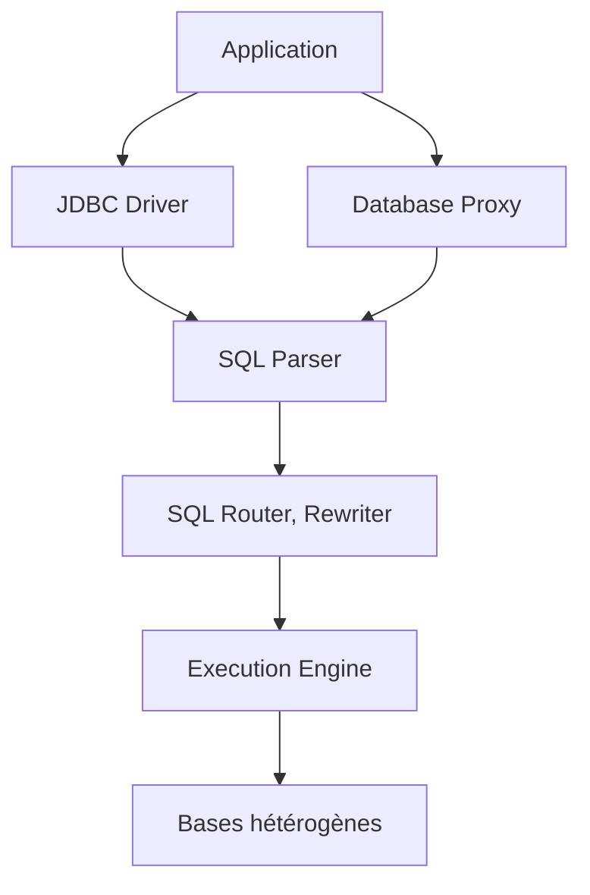

# apache/shardingsphere

> Couche d'amélioration au-dessus de bases hétérogènes : sharding, chiffrement et fédération SQL, via JDBC ou proxy.

## Le problème
Faire d'un ensemble de bases hétérogènes ou shardées un accès unifié, sans migrer vers une base distribuée.

## Ce que ça fait vraiment
Deux points d'accès : ShardingSphere-JDBC (pilote Java) et ShardingSphere-Proxy (protocole MySQL/PostgreSQL). Le SQL est analysé, routé, réécrit, exécuté puis fusionné. Fonctions : sharding, séparation lecture/écriture, transactions distribuées, chiffrement, masquage, base fantôme, observabilité, DistSQL, migration de données, workflows MCP.

## Comment c'est branché

## Essayer
Aucune commande dans le README (renvoie au wiki et à la documentation officielle).

## Coût et pièges
Le cache ANTLR du JDBC peut gonfler le tas Java : fixer `-Xmx`. Registre (ZooKeeper, etcd) à exploiter pour la gouvernance.

## Ce que ce n'est pas
Pas une base de données : il s'appuie sur tes bases existantes. Dépôt orienté Java.

## Alternatives
Aucune alternative nommée dans le README (compare seulement aux bases distribuées, middlewares et offres cloud).

## Pour toi
Ignorer : pensé pour le sharding OLTP en Java, hors des besoins courants d'un profil data/IA.

