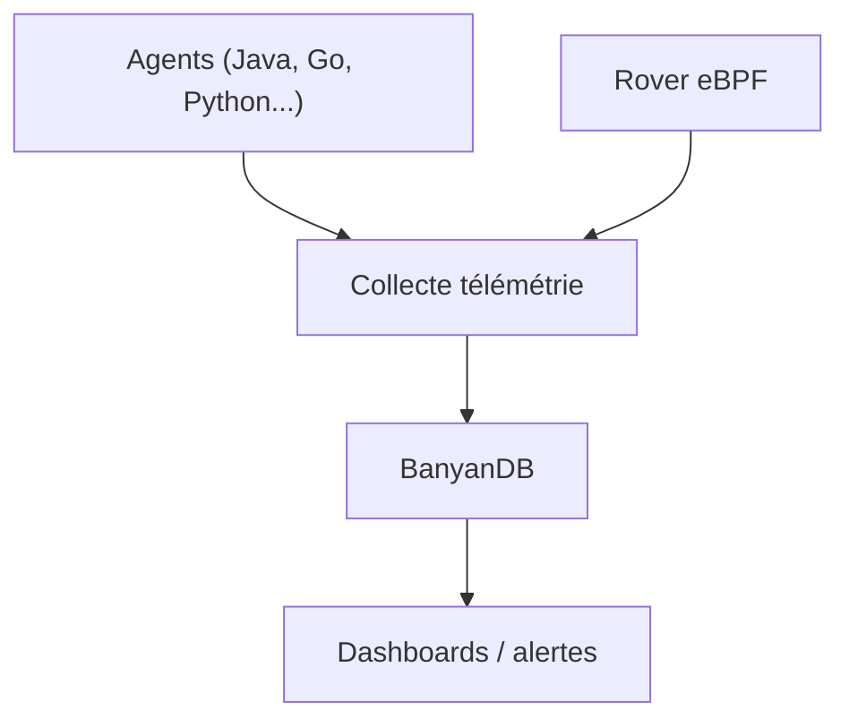

# apache/skywalking

> Open source APM system for microservices: distributed tracing, metrics, logs and alerting.

## The problem
Diagnosing slowdowns and outages in distributed architectures without end-to-end visibility.

## What it actually does
End-to-end tracing, service topology, agents (Java, .NET, PHP, Node, Go, Python, etc.), Rover eBPF agent for Kubernetes, BanyanDB observability database, ingestion of Zipkin, OpenTelemetry, Prometheus, Zabbix, Fluentd, log and alerting pipelines, ML-based anomaly detection.

## How it is wired
No diagram or architecture provided; only the README's list of capabilities is known.

This diagram only uses the elements cited; links are deduced from the README.

## Trying it
No command in the README: see the official documentation, the releases page and the build document.

## Cost and gotchas
Free; infrastructure cost (telemetry storage, cluster) is on you. Mailing list for support.

## What it is not
Not an MLOps tool: it observes services, not models. Requires a server deployment, the README does not detail installation.

## Alternatives
None named apart from the supported ecosystems (Zipkin, OpenTelemetry, Prometheus).

## For you
Watch: relevant if you operate model-serving services as microservices and want tracing.
