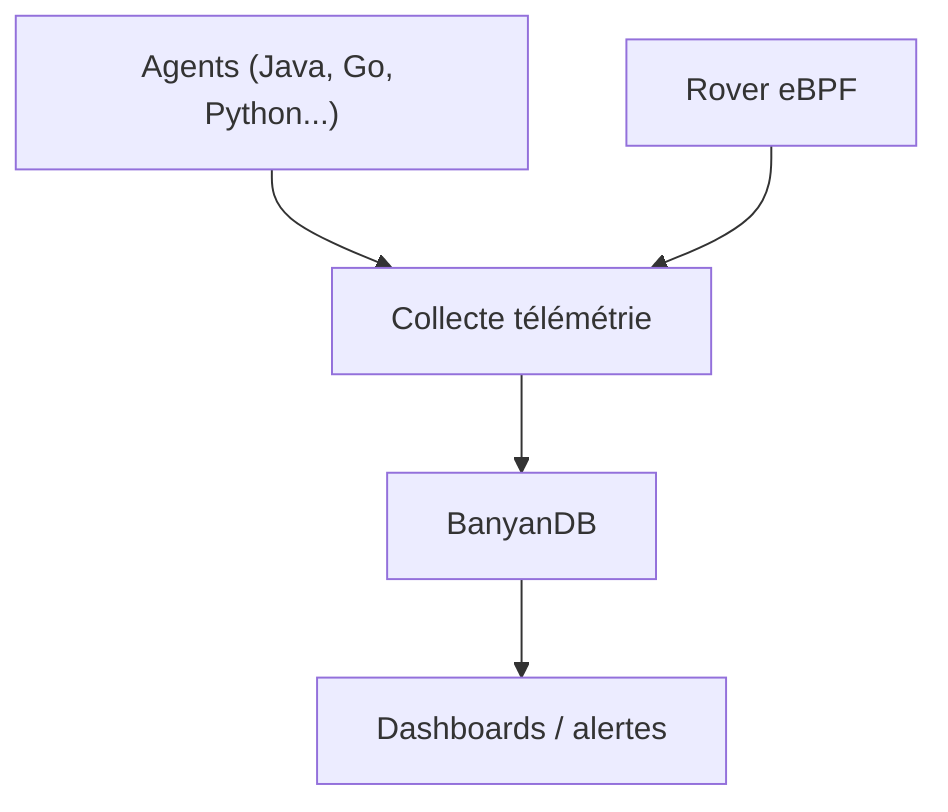

# apache/skywalking

> Système APM open source pour microservices : traçage distribué, métriques, logs et alertes.

## Le problème
Diagnostiquer lenteurs et pannes dans des architectures distribuées sans visibilité bout en bout.

## Ce que ce n'est pas
Pas un outil de MLOps : il observe des services, pas des modèles. Exige un déploiement serveur, le README ne détaille pas l'installation.

## Ce que ça fait vraiment
Traçage de bout en bout, topologie de services, agents (Java, .NET, PHP, Node, Go, Python, etc.), agent eBPF Rover pour Kubernetes, base d'observabilité BanyanDB, ingestion Zipkin, OpenTelemetry, Prometheus, Zabbix, Fluentd, pipelines de logs et d'alertes, détection d'anomalies par ML.

## Comment c'est branché
Aucun diagramme ni architecture fournis ; seule la liste des capacités du README est connue.

Ce schéma reprend uniquement les éléments cités, liens déduits du README.

## Essayer
Aucune commande dans le README : voir la documentation officielle, la page des releases et le document de compilation.

## Coût et pièges
Gratuit ; coût d'infrastructure (stockage de télémétrie, cluster) à ta charge. Liste de diffusion pour le support.

## Alternatives
Aucune nommée hors les écosystèmes supportés (Zipkin, OpenTelemetry, Prometheus).

## Pour toi
À surveiller : pertinent si tu opères des services de serving de modèles en microservices et veux du traçage.

