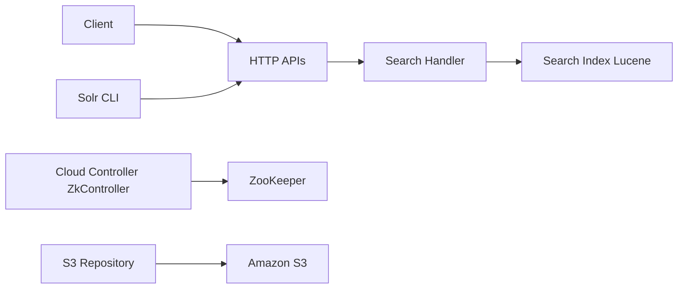

# apache/solr

> Apache search platform built on Lucene: full-text, vector and geospatial, for search teams.

## The problem
Indexing large volumes of documents and querying them quickly, including vector search, in a distributed way.

## What it actually does
A search server with HTTP APIs and a CLI for collections and schemas, with full-text, vector and geospatial search. SolrCloud coordinates nodes through ZooKeeper. Ships with examples (cloud, techproducts, schemaless, films), an official Docker image and a Kubernetes operator. Built with Gradle.

## How it is wired


## Trying it
```bash
bin/solr start -e techproducts
./gradlew dev
cd ./solr/packaging/build/dev
bin/solr start
```

## Cost and gotchas
Free; cluster mode requires ZooKeeper. Admin interface at `http://localhost:8983/solr/`.

## What it is not
Not a transactional database. The README announces vector search without performance figures.

## Alternatives
No alternative named in the README.

## For you
Worth watching: a solid search building block for RAG or full-text indexing if you are already in the Lucene/JVM ecosystem.
