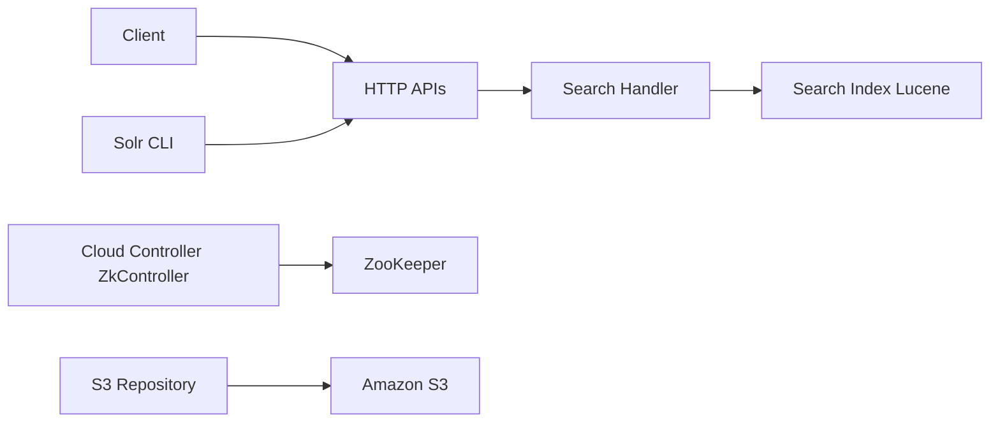

# apache/solr

> Plateforme de recherche Apache construite sur Lucene : plein texte, vectoriel et géospatial, pour équipes de recherche.

## Le problème
Indexer de gros volumes de documents et les interroger vite, y compris en recherche vectorielle, de façon distribuée.

## Ce que ça fait vraiment
Serveur de recherche avec APIs HTTP et CLI pour collections et schémas, recherche plein texte, vectorielle et géospatiale. SolrCloud coordonne les nœuds via ZooKeeper. Livré avec des exemples (cloud, techproducts, schemaless, films), une image Docker officielle et un opérateur Kubernetes. Build avec Gradle.

## Comment c'est branché


## Essayer
```bash
bin/solr start -e techproducts
./gradlew dev
cd ./solr/packaging/build/dev
bin/solr start
```

## Coût et pièges
Gratuit ; le mode cluster demande ZooKeeper. Interface d'admin sur `http://localhost:8983/solr/`.

## Ce que ce n'est pas
Pas une base de données transactionnelle. Le README annonce la recherche vectorielle sans chiffres de performance.

## Alternatives
Aucune alternative nommée dans le README.

## Pour toi
À surveiller : brique de recherche solide pour du RAG ou de l'index plein texte si tu es déjà dans l'écosystème Lucene/JVM.

