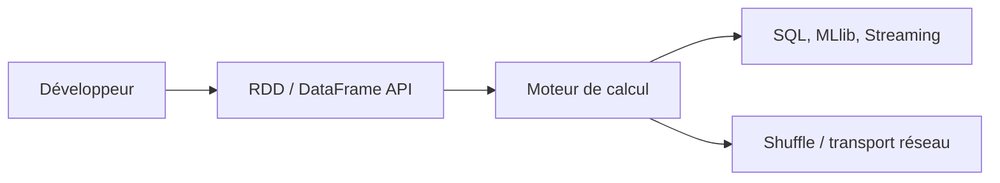

# apache/spark

> Distributed analytics engine for large data, with Scala, Java, Python APIs: SQL, MLlib, streaming.

## The problem
A dataset exceeds the memory or time of a single machine and the computation must be parallelized.

## What it actually does
Runs computation graphs on a cluster or locally. On this engine: Spark SQL/DataFrames, pandas API, MLlib, GraphX, Structured Streaming. The R API is marked deprecated. The repository also contains a shuffle transport and pipelines.

## How it is wired


## Trying it
```bash
./build/mvn -DskipTests clean package
./bin/pyspark
./bin/run-example SparkPi
```
Test: `spark.range(1000 * 1000 * 1000).count()` must return 1,000,000,000.

## Cost and gotchas
Free; building from source is long. The Hadoop version must be aligned with the cluster's. For common use, a pre-built package avoids compilation.

## What it is not
Not a lightweight tool: oversized for a few GB of data. The README is only an installation basis.

## Alternatives
No alternative named in the README.

## For you
Adopt: the reference for distributed processing for a data/MLOps profile; on small data, aim instead for a local engine.
