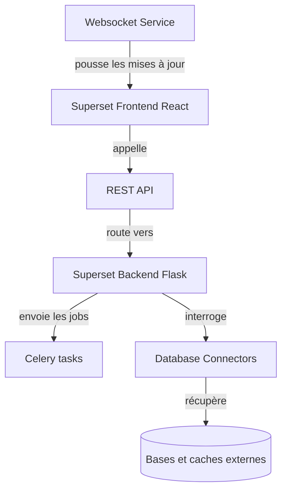

# apache/superset

> Open-source web application for business intelligence, used to explore data and create dashboards.

## The problem
Proprietary business intelligence (BI) tools are expensive and restrict access to data. Analysts want to query a SQL database and create charts without having to write code.

## What it actually does
A no-code charting tool, an SQL editor (SQL Lab), a lightweight semantic layer for defining dimensions and metrics, dashboards, and a configurable cache. It connects to almost any SQL database via SQLAlchemy. The architecture includes a Flask backend, a React frontend, a WebSocket service, and Celery tasks for long-running queries.

## How it is wired


## Trying it
```bash
# Le README ne donne aucune commande : il renvoie au guide de démarrage rapide
# et à « Superset in 2 Minutes using Docker Compose » dans la documentation.
```

## Cost and gotchas
It's free, but you need to host it: a backend, a metadata database, and a Celery broker. Each database requires its own driver; the installation documentation for the drivers is essential.

## What it is not
This is not a data warehouse or an ETL tool; it reads existing databases. It is not a ready-to-use SaaS offering; the cloud offering is provided by a third-party vendor.

## Alternatives
No alternative is specified in the README file.

## For you
This is a recommended approach for establishing a BI layer for a data team: the Apache Foundation's project, which is widely used and includes an API for automation.
