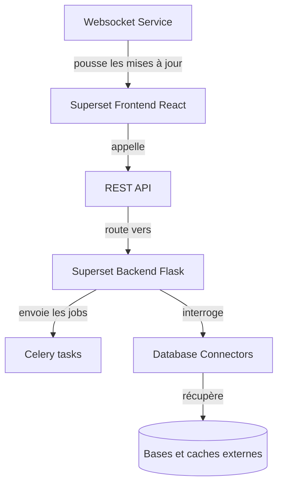

# apache/superset

> Application web de business intelligence open source pour explorer des données et bâtir des tableaux de bord.

## Le problème
Les outils de BI propriétaires sont chers et enferment les données. Les analystes veulent interroger une base SQL et publier des graphiques sans coder.

## Ce que ça fait vraiment
Un constructeur de graphiques sans code, un éditeur SQL (SQL Lab), une couche sémantique légère pour définir dimensions et métriques, des tableaux de bord et un cache configurable. Il se connecte à presque toute base SQL via SQLAlchemy. L'architecture comprend un backend Flask, un frontend React, un service websocket et des tâches Celery pour les requêtes longues.

## Comment c'est branché


## Essayer
```bash
# Le README ne donne aucune commande : il renvoie au guide de démarrage rapide
# et à « Superset in 2 Minutes using Docker Compose » dans la documentation.
```

## Coût et pièges
Gratuit, mais il faut l'héberger : backend, base de métadonnées, broker pour Celery. Chaque base demande son pilote ; la documentation d'installation des pilotes est un passage obligé.

## Ce que ce n'est pas
Ce n'est pas un entrepôt de données ni un outil d'ETL : il lit des bases existantes. Ce n'est pas un SaaS prêt à l'emploi ; l'offre cloud est celle d'un éditeur tiers.

## Alternatives
Aucune alternative nommée dans le README.

## Pour toi
À adopter pour donner une couche BI à une équipe data : projet de la fondation Apache, très répandu, avec une API pour automatiser.

