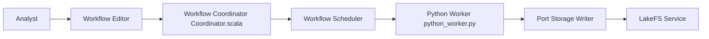

# apache/texera

> Data science platform built on visual workflows, with AI agents driven in natural language.

## The problem
Building analysis pipelines as a team, with live execution and debugging, forces you to write code or juggle several tools.

## What it actually does
You design a workflow in the graphical interface, or describe it to an AI agent. A coordinator schedules parallel execution on workers (Python and Java), which process tuples and return statistics and debugging state. Storage separates compute and data (S3, LakeFS, HDFS, Git for versions). Real-time collaboration is advertised. The project is in Apache incubation.

## How it is wired

## Trying it
No command documented in the README provided.

## Cost and gotchas
Free (Apache-2.0). Local or cloud deployment, details not specified. "Incubating" status: maturity not guaranteed. 734 open issues. The AI agents probably assume an external language model, not specified.

## What it is not
Not a notebook nor an MLOps experiment-tracking tool: it is a data workflow editor. The README's announcements cannot be verified here.

## Alternatives
The README names no alternative.

## For you
Watch: concept close to your field (data workflows with AI agents, Apache project), but in incubation and with no installation documented here.
