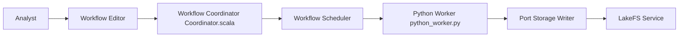

# apache/texera

> Plateforme de data science par workflows visuels, avec agents IA pilotés en langage naturel.

## Le problème
Construire des pipelines d'analyse à plusieurs, avec exécution et débogage en direct, oblige à écrire du code ou à jongler entre plusieurs outils.

## Ce que ça fait vraiment
On conçoit un workflow dans l'interface graphique, ou on le décrit à un agent IA. Un coordinateur planifie l'exécution en parallèle sur des workers (Python et Java), qui traitent les tuples et renvoient statistiques et état de débogage. Le stockage sépare calcul et données (S3, LakeFS, HDFS, Git pour les versions). La collaboration en temps réel est annoncée. Le projet est en incubation Apache.

## Comment c'est branché

## Essayer
Aucune commande documentée dans le README fourni.

## Coût et pièges
Gratuit (Apache-2.0). Déploiement local ou cloud, détail non précisé. Statut « incubating » : maturité non garantie. 734 issues ouvertes. Les agents IA supposent probablement un modèle de langage externe, non précisé.

## Ce que ce n'est pas
Pas un notebook ni un outil MLOps de suivi d'expériences : c'est un éditeur de workflows de données. Les annonces du README ne sont pas vérifiables ici.

## Alternatives
Le README ne nomme pas d'alternative.

## Pour toi
Surveiller : concept proche de ton métier (workflows de données avec agents IA, projet Apache), mais en incubation et sans installation documentée ici.

