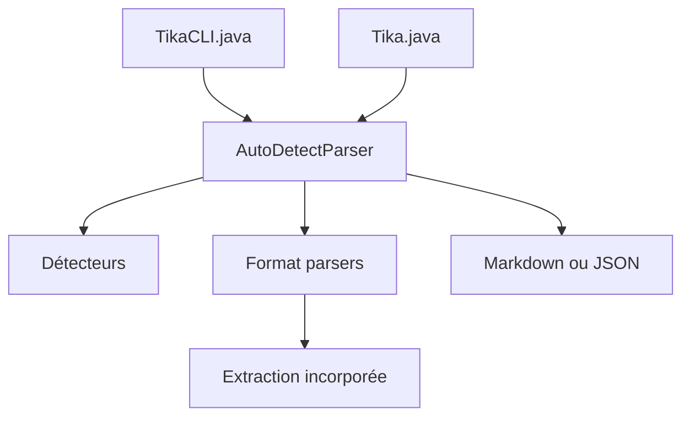

# apache/tika

> Java toolkit that detects file types and extracts text and metadata from them, as Markdown by default.

## The problem
Feeding a search engine or a RAG pipeline requires reading thousands of document formats, some of them booby-trapped.

## What it actually does
Tika detects over a thousand file types and extracts text and metadata from them. Since 4.0, the default output is Markdown, with recursive JSON extraction of embedded documents. Parsing can run in isolated processes (Tika Pipes) so that a booby-trapped document only kills its own process. Vision-model parsers (Claude, Gemini, OpenAI) and an emitter to OpenSearch exist.

## How it is wired


## Trying it
```bash
java -jar tika-app-<version>.jar document.pdf
java -jar tika-app-<version>.jar --text document.pdf
java -jar tika-app-<version>.jar -J document.pdf
./mvnw clean install
```

## Cost and gotchas
Free. Java 17 required; the `tika-app` jar must stay next to its `lib/` folder. Moving from 3.x to 4.x breaks configuration (JSON instead of XML). Vision parsers call an external service requiring an API key.

## What it is not
It is not an OCR engine on its own, nor a managed service. The Markdown produced is not a faithful layout.

## Alternatives
No alternative named in the README.

## For you
Adopt: a mature, foundation-backed building block for converting documents to clean text before a RAG pipeline.
