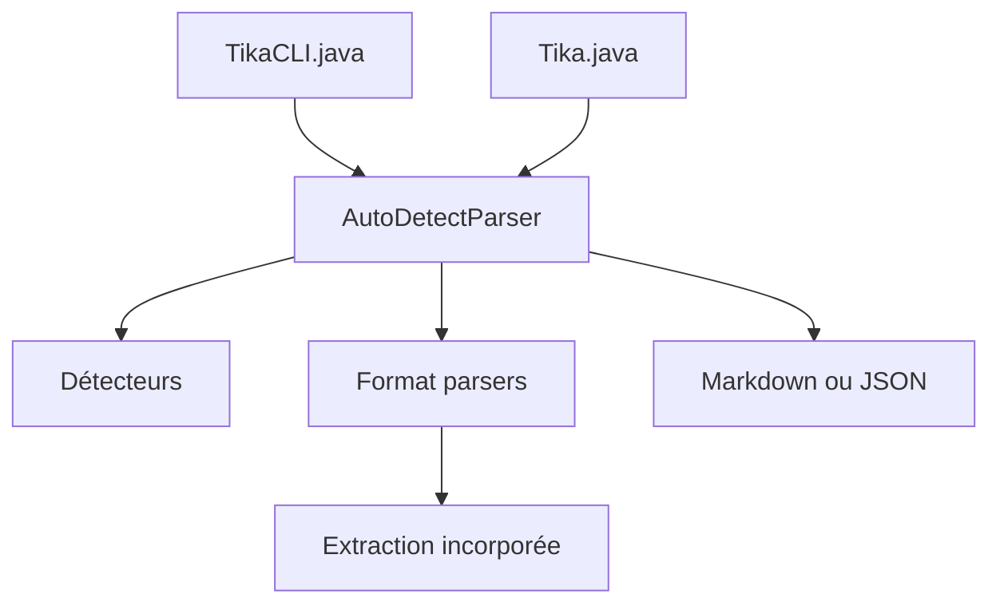

# apache/tika

> Boîte à outils Java qui détecte les types de fichiers et en extrait texte et métadonnées, en Markdown par défaut.

## Le problème
Alimenter un moteur de recherche ou un pipeline RAG exige de lire des milliers de formats de documents, dont certains piégés.

## Ce que ça fait vraiment
Tika détecte plus d'un millier de types de fichiers et en extrait texte et métadonnées. Depuis la 4.0, la sortie par défaut est du Markdown, avec une extraction récursive en JSON des documents incorporés. L'analyse peut tourner dans des processus isolés (Tika Pipes) pour qu'un document piégé ne tue que son processus. Des analyseurs à modèle de vision (Claude, Gemini, OpenAI) et un émetteur vers OpenSearch existent.

## Comment c'est branché


## Essayer
```bash
java -jar tika-app-<version>.jar document.pdf
java -jar tika-app-<version>.jar --text document.pdf
java -jar tika-app-<version>.jar -J document.pdf
./mvnw clean install
```

## Coût et pièges
Gratuit. Java 17 requis, le jar de `tika-app` doit rester à côté de son dossier `lib/`. Le passage de la 3.x à la 4.x casse la configuration (JSON au lieu de XML). Les analyseurs de vision appellent un service externe à clé d'API.

## Ce que ce n'est pas
Ce n'est pas un moteur OCR à lui seul, ni un service géré. Le Markdown produit n'est pas une mise en page fidèle.

## Alternatives
Aucune alternative nommée dans le README.

## Pour toi
À adopter : brique mûre et soutenue par une fondation pour convertir des documents en texte propre avant un pipeline RAG.

