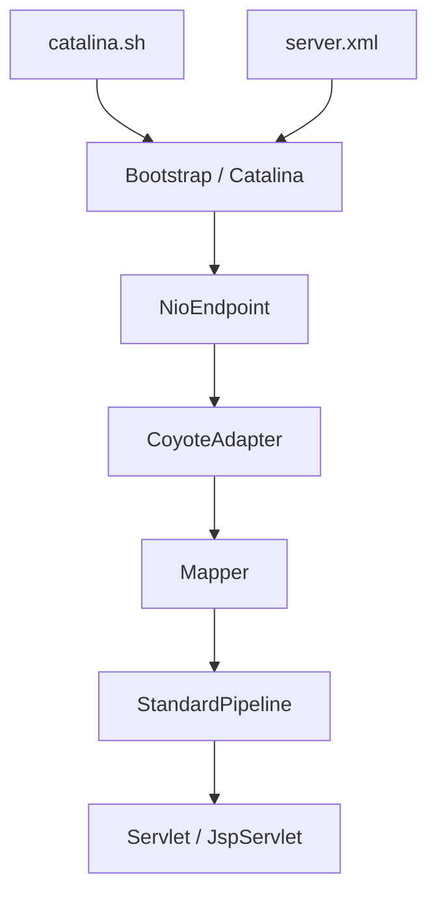

# apache/tomcat

> Java servlet container (Jakarta Servlet, Pages, EL, WebSocket) for running web applications on the JVM.

## The problem
A Java web application needs a server that speaks HTTP, handles sessions, security and webapp deployment.

## What it actually does
Tomcat accepts connections (NIO, TLS), decodes HTTP/1.1, HTTP/2 or AJP, routes the request to the right host, webapp and servlet, then returns the response. Each webapp has its own class loader. It also provides JSP, sessions, JNDI, JMX and optional clustering.

## How it is wired


## Trying it
```bash
# README : voir RUNNING.txt pour l'installation
# Les commandes ne sont pas détaillées dans le README ; le lancement passe par bin/startup.sh (cité dans l'architecture)
```

## Cost and gotchas
Free, but you need a JVM and must pick the right major version (11, 10 or 9). The README points to RUNNING.txt for everything else.

## What it is not
It is not a full Jakarta EE application server: it implements only Servlet, Pages, EL and WebSocket. It is not a tool for Python or data.

## Alternatives
No alternative named in the README.

## For you
Watch only: useful if you deploy a Java service (for example a JVM inference server), unrelated to a Python data/AI workflow.
