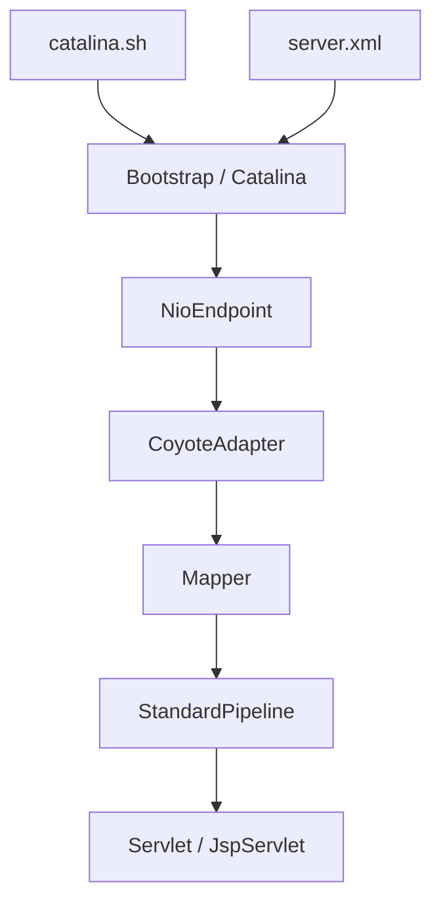

# apache/tomcat

> Conteneur de servlets Java (Jakarta Servlet, Pages, EL, WebSocket) pour exécuter des applications web sur JVM.

## Le problème
Une application web Java a besoin d'un serveur qui parle HTTP, gère les sessions, la sécurité et le déploiement des webapps.

## Ce que ça fait vraiment
Tomcat accepte les connexions (NIO, TLS), décode HTTP/1.1, HTTP/2 ou AJP, route la requête vers le bon hôte, la bonne webapp et la bonne servlet, puis renvoie la réponse. Chaque webapp a son propre chargeur de classes. Il fournit aussi JSP, sessions, JNDI, JMX, clustering optionnel.

## Comment c'est branché


## Essayer
```bash
# README : voir RUNNING.txt pour l'installation
# Les commandes ne sont pas détaillées dans le README ; le lancement passe par bin/startup.sh (cité dans l'architecture)
```

## Coût et pièges
Gratuit, mais il faut une JVM et choisir la bonne version majeure (11, 10 ou 9). Le README renvoie à RUNNING.txt pour tout le reste.

## Ce que ce n'est pas
Ce n'est pas un serveur d'applications Jakarta EE complet : il implémente Servlet, Pages, EL et WebSocket seulement. Ce n'est pas un outil pour Python ou data.

## Alternatives
Aucune alternative nommée dans le README.

## Pour toi
À surveiller seulement : utile si tu déploies un service Java (par exemple un serveur d'inférence JVM), sans rapport avec un flux data/IA Python.

