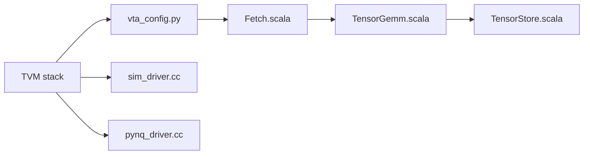

# apache/tvm-vta

> Open source tensor hardware accelerator, with a TVM compiler stack, for prototyping inference on FPGA.

## The problem
Evaluating or designing a deep learning accelerator without starting from scratch on hardware, drivers and compiler.

## What it actually does
Provides a modular hardware design (Chisel/Scala: fetch, tensor load/store, GEMM, ALU), simulators to test compilation passes on a workstation, a runtime/drivers (Pynq, OpenCL FPGA) and a TVM integration. FPGA deployment goes through RPC driven from Python.

## How it is wired

## Trying it
No command documented in the provided README excerpt: see the TVM/VTA documentation.

## Cost and gotchas
An FPGA board is needed for the real hardware; the simulator is enough for prototyping. Last push in April 2024.

## What it is not
Not a training framework nor a GPU-ready runtime. Internal links that were not sampled are not established.

## Alternatives
No alternative named in the README (TVM itself is the compiler building block).

## For you
Ignore unless you do hardware/software co-design: this is FPGA research, with little connection to a daily MLOps routine, and the repository has been quiet since 2024.
