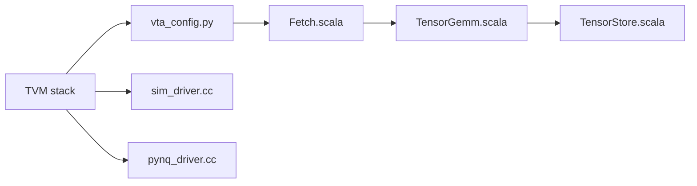

# apache/tvm-vta

> Accélérateur matériel open source de tenseurs, avec pile compilateur TVM, pour prototyper l'inférence sur FPGA.

## Le problème
Évaluer ou concevoir un accélérateur de deep learning sans repartir de zéro côté matériel, pilotes et compilateur.

## Ce que ça fait vraiment
Fournit un design matériel modulaire (Chisel/Scala : fetch, chargement/stockage de tenseurs, GEMM, ALU), des simulateurs pour tester les passes de compilation sur station de travail, un runtime/pilotes (Pynq, OpenCL FPGA) et une intégration TVM. Déploiement FPGA via RPC piloté depuis Python.

## Comment c'est branché

## Essayer
Aucune commande documentée dans l'extrait du README fourni : voir la documentation TVM/VTA.

## Coût et pièges
Besoin d'une carte FPGA pour le vrai matériel ; le simulateur suffit pour prototyper. Dernier push en avril 2024.

## Ce que ce n'est pas
Pas un framework d'entraînement ni un runtime prêt pour GPU. Les liens internes non échantillonnés ne sont pas établis.

## Alternatives
Aucune alternative nommée dans le README (TVM lui-même est la brique compilateur).

## Pour toi
À ignorer sauf si tu fais du co-design matériel/logiciel : c'est de la recherche FPGA, peu de lien avec un quotidien MLOps, et le dépôt est calme depuis 2024.

