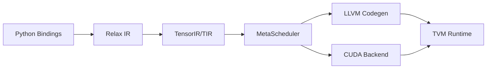

# apache/tvm

> Python-first ML model compiler for deploying on a wide range of hardware.

## The problem
A trained model must run fast on CPUs, GPUs, mobile or varied accelerators, each with its own libraries.

## What it actually does
Graph (Relax) and tensor (TensorIR) representations that can be optimized jointly, with transformations written in Python.
MetaScheduler for auto-tuning schedules.
Code generation for LLVM, CUDA, ROCm, Vulkan, OpenCL, Metal, WebGPU; runtime with RPC.
Foundation for vertical compilers, notably for LLMs.

## How it is wired

## Trying it
No command documented in the README (points to the documentation).

## Cost and gotchas
Free; installation often means building from source, and the learning curve is real.

## What it is not
Not an out-of-the-box inference server; the current design differs strongly from older versions (Relay).

## Alternatives
No alternative named as a repository; Halide, Loopy and Theano are cited as inspirations.

## For you
Worth watching: useful if you target optimized edge deployment, overkill for serving a model on a standard GPU.
