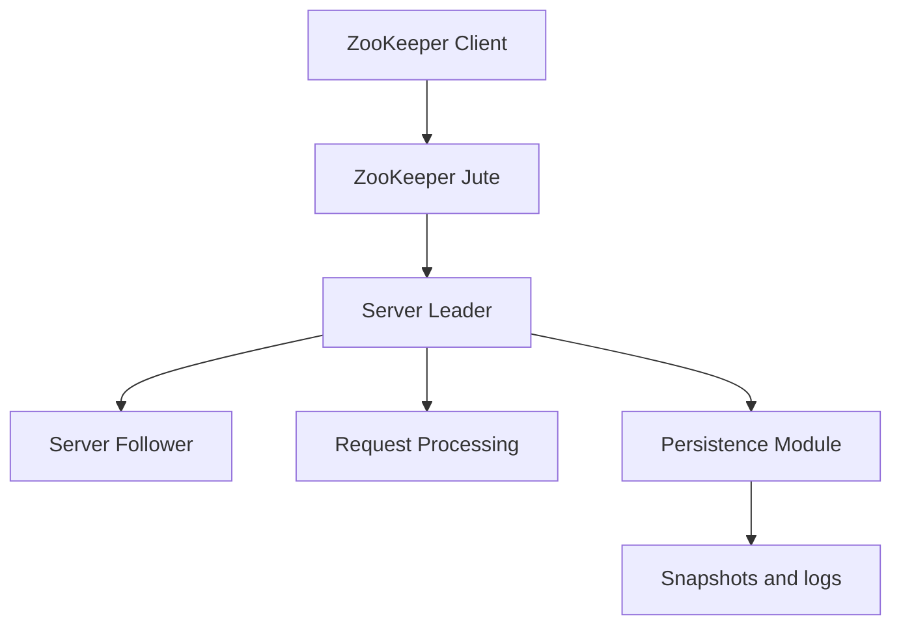

# apache/zookeeper

> Distributed coordination service, published by the Apache foundation.

## The problem
Coordinating distributed nodes (configuration, leader election, locks) without reinventing consensus.

## What it actually does
The provided README only covers packaging: source and binary archives, building with Maven (`mvn clean install`), artifacts published on Maven Central. From the architecture: a server with a leader and followers (Zab protocol), sessions, a data tree, persistence through logs and snapshots, Java and C clients, and the Jute serialization layer.

## How it is wired


## Trying it
```bash
mvn clean install
mvn javadoc:aggregate
```

## Cost and gotchas
Free. Requires Java and Maven, which are missing from the prerequisites list. Minimal README.

## What it is not
It is not a database or a message bus: it is a coordination service. No getting-started guide in the sheet.

## Alternatives
No alternative named in the README.

## For you
Ignore: you do not use it directly in data or AI work, and the README gives nothing to try.
