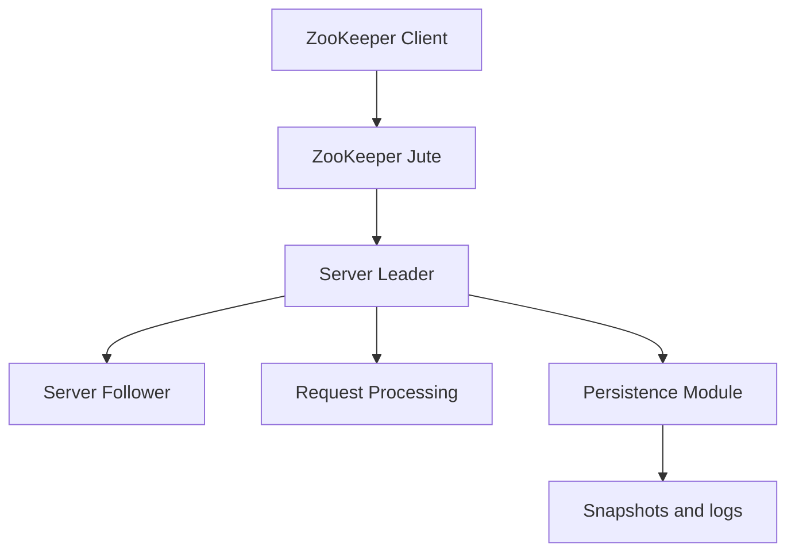

# apache/zookeeper

> Service de coordination distribué, publié par la fondation Apache.

## Le problème
Coordonner des nœuds distribués (configuration, élection de leader, verrous) sans réinventer le consensus.

## Ce que ça fait vraiment
Le README fourni ne parle que de l'empaquetage : archives source et binaire, construction avec Maven (`mvn clean install`), artefacts publiés sur Maven Central. D'après l'architecture : un serveur avec leader et suiveurs (protocole Zab), sessions, arbre de données, persistance par journaux et instantanés, clients Java et C, couche de sérialisation Jute.

## Comment c'est branché


## Essayer
```bash
mvn clean install
mvn javadoc:aggregate
```

## Coût et pièges
Gratuit. Nécessite Java et Maven, absents de la liste de prérequis. README minimal.

## Ce que ce n'est pas
Ce n'est pas une base de données ni un bus de messages : c'est un service de coordination. Aucun guide de prise en main dans la fiche.

## Alternatives
Aucune alternative nommée dans le README.

## Pour toi
À ignorer : on ne l'utilise pas directement dans un travail data ou IA, et le README ne donne rien à essayer.

