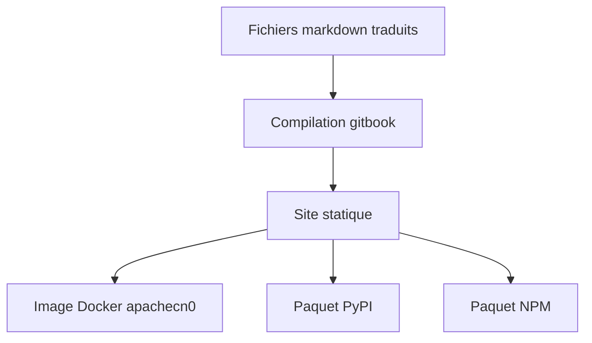

# apachecn/sklearn-doc-zh

> Chinese translation of the scikit-learn documentation, readable as a local site via Docker, pip or npm.

## The problem
The official scikit-learn documentation is in English, a barrier for Chinese-speaking readers.

## What it actually does
The repo contains the translated user guide (supervised and unsupervised learning, model selection, data transformation, computing tools), the tutorials and the API reference. It is served locally on a port. Versions 0.18 and 0.19 also exist. The repo belongs to the ApacheCN community.

## How it is wired
Simplified diagram based on the sheet, no diagram provided.



## Trying it
```bash
docker pull apachecn0/sklearn-doc-zh
docker run -tid -p <port>:80 apachecn0/sklearn-doc-zh
pip install sklearn-doc-zh
sklearn-doc-zh <port>
```

## Cost and gotchas
Free. The license is not identified by GitHub; the README states that ApacheCN projects without a license are under CC BY-NC-SA 4.0 (non-commercial use). The content dates from scikit-learn versions 0.18/0.19.

## What it is not
It is not the up-to-date scikit-learn documentation. It is not library code: it is only a translation.

## Alternatives
No alternative named in the README (the official site is cited as a link).

## For you
Ignore: outdated documentation in Chinese brings you nothing, the official reference remains the source.
