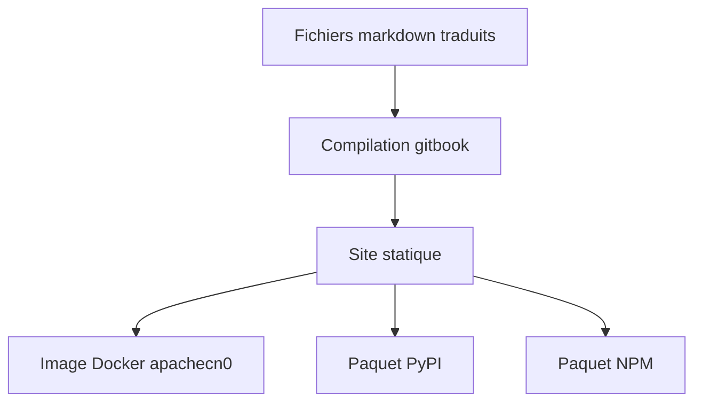

# apachecn/sklearn-doc-zh

> Traduction chinoise de la documentation scikit-learn, lisible en site local via Docker, pip ou npm.

## Le problème
La documentation officielle de scikit-learn est en anglais, un frein pour des lecteurs sinophones.

## Ce que ça fait vraiment
Le dépôt contient le guide utilisateur traduit (apprentissage supervisé et non supervisé, sélection de modèle, transformation de données, outils de calcul), les tutoriels et la référence API. Il se sert en local sur un port. Les versions 0.18 et 0.19 existent aussi. Le dépôt appartient à la communauté ApacheCN.

## Comment c'est branché
Schéma simplifié d'après la fiche, sans diagramme fourni.



## Essayer
```bash
docker pull apachecn0/sklearn-doc-zh
docker run -tid -p <port>:80 apachecn0/sklearn-doc-zh
pip install sklearn-doc-zh
sklearn-doc-zh <port>
```

## Coût et pièges
Gratuit. La licence n'est pas identifiée par GitHub ; le README indique que les projets ApacheCN sans licence sont sous CC BY-NC-SA 4.0 (usage non commercial). Le contenu date des versions 0.18/0.19 de scikit-learn.

## Ce que ce n'est pas
Ce n'est pas la documentation à jour de scikit-learn. Ce n'est pas du code de bibliothèque : c'est seulement une traduction.

## Alternatives
Aucune alternative nommée dans le README (le site officiel est cité en lien).

## Pour toi
À ignorer : une documentation vieillie et en chinois ne t'apporte rien, la référence officielle reste la source.

